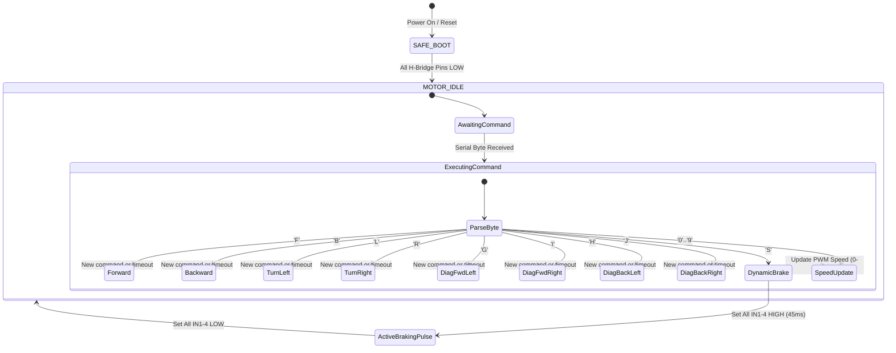
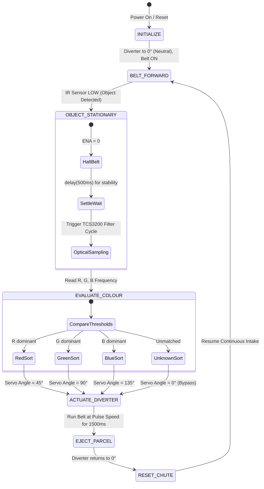
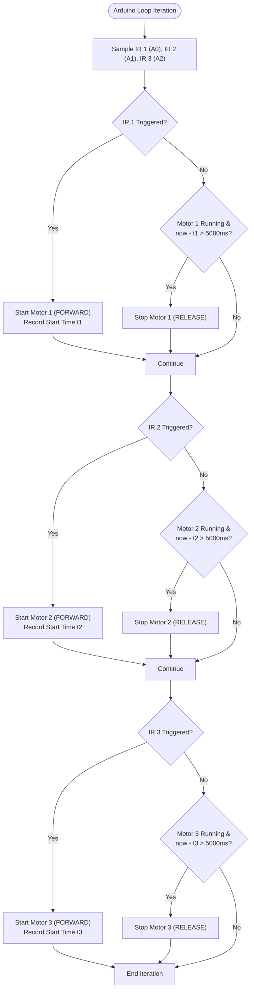

# Block Diagrams: Conveyor Belt with Portable Robotic Arm

This document provides formal system-level and subsystem-level architectural block diagrams using standard Mermaid syntax.

---

## 1. Complete System Integration Diagram

```mermaid
flowchart TD
    subgraph UI["Operator Interface Layer"]
        App["Android Mobile App (Flutter)"]
        WebDash["Web Demonstration Console (HTML5/Canvas)"]
    end

    subgraph RF["Wireless Telemetry & Video Link"]
        BT1["HC-05 Bluetooth Module 1 (Base)"]
        BT2["HC-05 Bluetooth Module 2 (Arm)"]
        WiFi["Wi-Fi Network (802.11 b/g/n)"]
    end

    subgraph Power["Power Distribution Subsystem"]
        LiPo["11.1V 3S LiPo Battery (2200mAh 30C)"]
        Fuse["10A Inline Fuse & Master Switch"]
        Buck5V["5V 3A DC-DC Buck Converter"]
        BuckServo["5V-6V 3A High-Current Servo Rail"]
        GNDBus["Common Ground Reference Bus"]
    end

    subgraph BaseSub["Subsystem 1: Portable Robotic Base"]
        Uno1["Arduino Uno #1 (Base Controller)"]
        L298N_Base["L298N Motor Driver"]
        M_FL["Front-Left BO Motor"]
        M_BL["Back-Left BO Motor"]
        M_FR["Front-Right BO Motor"]
        M_BR["Back-Right BO Motor"]
    end

    subgraph ArmSub["Subsystem 2: Portable Robotic Arm"]
        Uno2["Arduino Uno #2 (Arm Controller)"]
        L293D_Arm["L293D Motor Shield"]
        M_Waist["30 RPM Waist Motor (M1)"]
        M_Shoulder["10 RPM Shoulder Motor (M2)"]
        M_Elbow["10 RPM Elbow Motor (M3)"]
        Act_Gripper["Gripper Motor / Servo (M4)"]
    end

    subgraph VisionSub["Subsystem 5: Surveillance Camera"]
        ESP32["ESP32-CAM (AI-Thinker)"]
        OV2640["OV2640 2MP Camera Sensor"]
        FlashLED["On-board White Flash LED"]
    end

    subgraph Conv1Sub["Subsystem 3: Colour-Sorting Conveyor"]
        Uno3["Arduino Uno #3 (Sorting Controller)"]
        L298N_Conv["L298N Motor Driver"]
        TCS["TCS3200 Optical Sensor"]
        IR_Sort["IR Optical Obstacle Gate"]
        Servo_Div["MG946R Diverter Servo"]
        M_SortBelt["100 RPM BO Belt Drive"]
    end

    subgraph Conv3Sub["Subsystem 4: 3-Stage Transfer Conveyor"]
        Uno4["Arduino Uno #4 (Transfer Controller)"]
        L293D_Conv["L293D Motor Shield"]
        IR1["IR Sensor 1"]
        IR2["IR Sensor 2"]
        IR3["IR Sensor 3"]
        M_Conv1["Conveyor 1 BO Motor"]
        M_Conv2["Conveyor 2 BO Motor"]
        M_Conv3["Conveyor 3 BO Motor"]
    end

    %% UI Connections
    App -->|Bluetooth SPP| BT1
    App -->|Bluetooth SPP| BT2
    App -->|HTTP Stream| WiFi
    WebDash -->|HTTP / Simulated Bridge| WiFi

    %% Wireless Links
    BT1 -->|UART Pins 0/1| Uno1
    BT2 -->|UART Pins 0/1| Uno2
    WiFi <-->|MJPEG Video Stream| ESP32

    %% Power Distribution
    LiPo --> Fuse
    Fuse --> Buck5V
    Fuse --> BuckServo
    Fuse -->|Raw 11.1V| L298N_Base
    Fuse -->|Raw 11.1V| L293D_Arm
    Buck5V -->|Regulated 5V| Uno1
    Buck5V -->|Regulated 5V| Uno2
    Buck5V -->|Regulated 5V| Uno3
    Buck5V -->|Regulated 5V| Uno4
    Buck5V -->|Regulated 5V| ESP32
    Buck5V -->|Regulated 5V| BT1
    Buck5V -->|Regulated 5V| BT2
    BuckServo -->|High Current 5V| Servo_Div

    %% Base Controls
    Uno1 -->|PWM Pins 5,6,10,11| L298N_Base
    L298N_Base -->|OUT1/OUT2| M_FL & M_BL
    L298N_Base -->|OUT3/OUT4| M_FR & M_BR

    %% Arm Controls
    Uno2 -->|Internal SPI/PWM| L293D_Arm
    L293D_Arm --> M_Waist
    L293D_Arm --> M_Shoulder
    L293D_Arm --> M_Elbow
    L293D_Arm --> Act_Gripper

    %% Vision Controls
    ESP32 --> OV2640
    ESP32 --> FlashLED

    %% Conveyor 1 Controls
    IR_Sort -->|Pin 7| Uno3
    TCS -->|Pins S0-S3, OUT| Uno3
    Uno3 -->|Pins 2,3,9| L298N_Conv
    Uno3 -->|Pin 10 PWM| Servo_Div
    L298N_Conv --> M_SortBelt

    %% Conveyor 3 Controls
    IR1 -->|Analog A0| Uno4
    IR2 -->|Analog A1| Uno4
    IR3 -->|Analog A2| Uno4
    Uno4 -->|Internal SPI/PWM| L293D_Conv
    L293D_Conv --> M_Conv1
    L293D_Conv --> M_Conv2
    L293D_Conv --> M_Conv3
```

---

## 2. Robotic Base Control & Motion Flow

---

## 3. Colour-Sorting Conveyor State Machine

---

## 4. 3-Stage Transfer Conveyor Non-Blocking FSM

